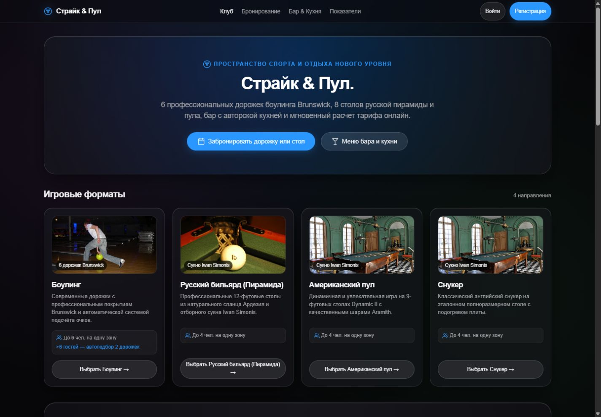

# Страйк & Пул

Учебный сайт боулинг- и бильярдного клуба на Django. Интерфейс собирается по [макету занятия 6](https://www.figma.com/design/3Umnb9IlotQspcCP82lTkr).

## Запуск

Нужен Python 3.12 или новее. Проект проверяется на Python 3.14.

```powershell
python -m venv .venv
.venv/Scripts/python.exe -m pip install -r requirements.txt
.venv/Scripts/python.exe manage.py migrate
.venv/Scripts/python.exe manage.py runserver
```

В Linux и macOS используйте `.venv/bin/python` вместо `.venv/Scripts/python.exe`.

База SQLite создаётся локально после миграций. База, виртуальное окружение, `.env` и пользовательские файлы `media` в репозиторий не входят.

## Структура

- `config/` — настройки проекта и общие маршруты.
- `club/` — приложение клуба.
- `templates/` — шаблоны страниц.
- `static/` — стили и изображения интерфейса.

## Занятие 7

Выполнены три этапа задания 7: созданы проект и приложение, подключены шаблоны, статика и SQLite, свёрстана главная страница по макету, настроены именованные маршруты проекта и приложения. Главная использует общий шаблон с шапкой и подвалом; игровые карточки, схема залов, тарифы и отзывы собраны отдельными разделами.

На этом этапе повторяющиеся блоки заполняются демонстрационными значениями из `club/demo_content.py`. Это данные для проверки вёрстки, а не действующие брони и отзывы посетителей. Подключение моделей относится к занятию 8. Фотографии игровых зон и иконки перенесены из исходных материалов макета; изображения лежат в `static/images` и включены в репозиторий.

```powershell
.venv/Scripts/python.exe manage.py check
```

Настройки предназначены для локальной разработки. `DJANGO_SECRET_KEY`, `DJANGO_DEBUG` и `DJANGO_ALLOWED_HOSTS` передаются через переменные окружения. Без заданного ключа при старте создаётся временный ключ; для постоянных сессий задайте свой ключ в окружении. Файл `.env` автоматически не загружается.

## Маршруты

| Имя | Адрес | Состояние |
| --- | --- | --- |
| `club:home` | `/` | Главная по макету |
| `club:booking_create` | `/bookings/create/` | Заглушка |
| `club:menu_catalog` | `/menu/` | Заглушка |
| `club:dashboard` | `/dashboard/` | Заглушка |
| `club:login` | `/login/` | Заглушка |
| `club:register` | `/register/` | Заглушка |
| `club:booking_list` | `/bookings/` | Заглушка |

Маршруты приложения подключены через `include`. Ссылки на страницы формируются тегом ``. Ссылка пропуска навигации ведёт к якорю основного содержимого.

Занятия 8 и 9 пока не выполнены. Заглушки нужны для проверки переходов; они не создают брони, не регистрируют пользователей и не выполняют расчёты. Надписи о расчёте тарифа и скидке на главной сохранены из макета. Следующим этапом будут остальные страницы и данные из моделей, затем формы и JavaScript.

## Проверка

```powershell
.venv/Scripts/python.exe manage.py check
.venv/Scripts/python.exe manage.py test
```

Тесты проверяют именованные маршруты, переходы, наличие изображений, семантические блоки и последовательность заголовков. На каждой странице один h1. Комментариев в исходном коде нет.

Главная проверена в Chrome при ширине окна 375 и 1440 px: горизонтального переполнения нет, четыре изображения загружаются, ошибок в консоли не обнаружено. Переход к бронированию и возврат на главную проверены вручную. Скриншоты первых экранов находятся в `docs/screenshots/`.



[Мобильный первый экран при ширине 375 px](docs/screenshots/home-375.jpg)
